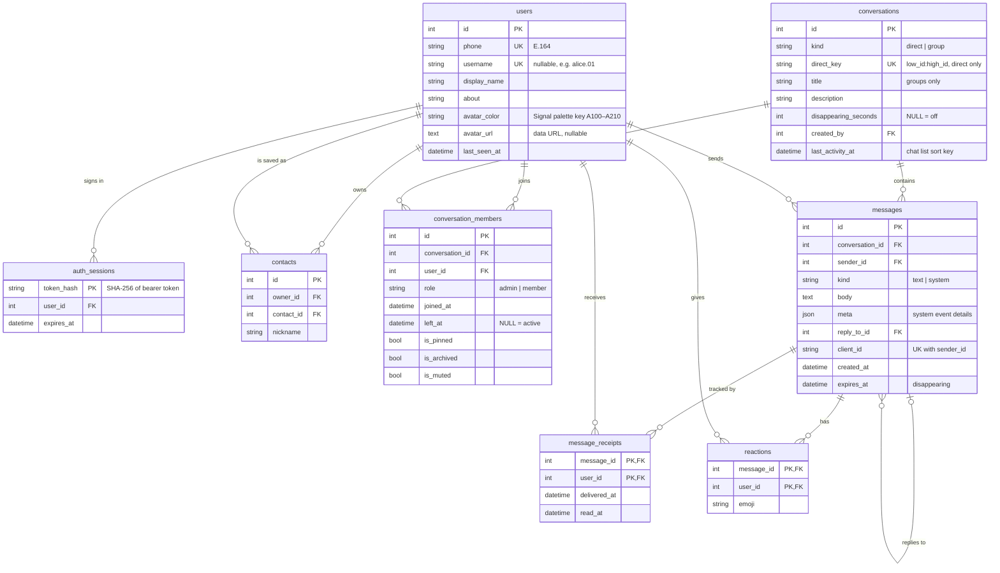

# Signal Clone

A functional clone of the Signal messenger: phone-number onboarding, contacts, 1:1 and group chats, and real-time messaging with sent / delivered / read receipts, typing indicators and presence.

- **Frontend:** Next.js 15 (App Router, TypeScript), Tailwind CSS, Zustand
- **Backend:** FastAPI, SQLAlchemy 2.0, SQLite
- **Real-time:** a single WebSocket per client (FastAPI / Starlette)

> Live demo: _TBD_ · API docs: `<backend-url>/docs`

## Demo accounts

Every number uses the verification code **`123456`** (verification is mocked).

| Name | Phone | Notes |
|---|---|---|
| Alice Chen | +1 555 010 0001 | Most seeded chats, admin of "Weekend Hike" |
| Bob Martinez | +1 555 010 0002 | |
| Priya Sharma | +1 555 010 0003 | Admin of "Product Team" |
| Diego Alvarez | +1 555 010 0006 | |

`+1 555 010 0004`, `…0005`, `…0007` and `…0008` also exist. Any other number registers a new account.

**Try it:** open Alice in one browser and Bob in a private window, then message each other to watch typing, delivery and read receipts update live.

## Running locally

**Backend** (Python 3.10+):

```bash
cd backend
python -m venv .venv && source .venv/bin/activate
pip install -r requirements-dev.txt
uvicorn app.main:app --reload            # http://localhost:8000, docs at /docs
pytest                                    # end-to-end REST + WebSocket tests
python -m app.seed --reset                # wipe and re-seed the database
```

The database (`backend/signal.db`) is created and seeded automatically on first start.

**Frontend** (Node 18.18+):

```bash
cd frontend
cp .env.example .env.local                # NEXT_PUBLIC_API_URL=http://localhost:8000
npm install
npm run dev                               # http://localhost:3000
```

## Architecture

```
Browser (Next.js)                          FastAPI (single process)
┌──────────────────────┐   REST /api/*    ┌───────────────────────────────┐
│ UI components        │ ───────────────▶ │ routers/   HTTP + validation  │
│ Zustand store        │                  │ services/  business rules     │
│ api.ts / socket.ts   │ ◀─── WS /ws ──── │ realtime   socket registry    │
└──────────────────────┘   server pushes  │ models     SQLAlchemy → SQLite│
                                          └───────────────────────────────┘
```

- **All writes go through REST** (send message, create group, add member…), so they get normal validation and error responses. After committing, the server pushes events to the affected users' sockets.
- **The WebSocket carries pushes plus cheap signals** from the client: `typing`, `read` and `ping`.
- **`realtime.ConnectionManager`** maps user id → open sockets (several tabs or devices per user). It lives in process memory, so the backend runs as **one instance**. Scaling out would mean swapping it for Redis pub/sub behind the same interface.
- **Disappearing messages:** a background task deletes expired messages every few seconds and pushes `message.deleted`. Expired rows are also filtered out of every query, so they never show up even between purges.

### Message status lifecycle

| Status | When | Where it lives |
|---|---|---|
| sending | Optimistic UI until `POST /messages` returns | client only |
| sent | Message stored; one `message_receipts` row created per recipient | server |
| delivered | Every recipient's device got the push (immediately if online, otherwise when their socket next connects) | `receipts.delivered_at` |
| read | Every recipient opened the chat | `receipts.read_at` |

Status is computed from receipts rather than stored on the message, so groups work the same way as 1:1 chats: a group message shows "read" once every member has read it. Each receipt change pushes the new aggregate status to the sender.

Retries are safe: the client sends a `client_id`, and `(sender_id, client_id)` is unique, so a retried request returns the original message instead of creating a duplicate.

## Database schema



### Design decisions

- **One `conversations` table for direct chats and groups.** Messages, receipts, unread counts and the chat list share one code path. A CHECK constraint enforces that `direct_key` is set if and only if the chat is direct.
- **`direct_key` is UNIQUE**, so two users can never end up with two separate 1:1 chats, even under concurrent requests. Note to Self is the direct chat `"<id>:<id>"`.
- **Membership is soft-deleted (`left_at`).** A removed member keeps read-only access to history up to their removal, as in Signal. Someone added later only sees messages from `joined_at` onward. Re-adding someone reopens the window.
- **Unread count = receipts with `read_at IS NULL`.** Status and unread badges come from the same table, so they can't drift apart. The `(user_id, read_at)` index keeps the query cheap.
- **System messages** ("Alice added Bob") are rows with `kind = 'system'`, an event key in `body` and details in `meta`. The client renders them from the viewer's perspective ("You added Bob" vs "Alice added Bob").
- **Only a hash of the session token is stored**, so a leaked database doesn't leak working sessions. Logout deletes the session row.
- **Foreign keys are enforced** (`PRAGMA foreign_keys=ON`) with explicit `ON DELETE` behaviour: receipts and reactions cascade with their message, and replies keep existing with `reply_to_id` set to NULL.

## API overview

All endpoints are under `/api` and take `Authorization: Bearer <token>`, except the auth endpoints. Interactive docs are at `/docs`.

| Method | Path | Purpose |
|---|---|---|
| POST | `/auth/request-otp` | Start registration or login (mock SMS; returns the code hint) |
| POST | `/auth/verify-otp` | Verify the code → `{token, user, needs_profile}`; creates the account on first login |
| POST | `/auth/logout` | Revoke the current session |
| GET / PATCH | `/users/me` | Read or update profile (name, about, avatar, username) |
| GET | `/users/lookup?q=` | Find a user by exact phone number or username |
| GET / POST | `/contacts` | List contacts / add one by phone or username |
| DELETE | `/contacts/{user_id}` | Remove a contact |
| GET | `/conversations` | Chat list with last message, unread count, members and presence |
| GET | `/conversations/{id}` | One conversation |
| POST | `/conversations/direct` | Get or create the 1:1 chat with a user |
| POST | `/conversations/group` | Create a group (creator becomes admin) |
| PATCH | `/conversations/{id}` | Group name / description / colour, disappearing timer (admins) |
| PATCH | `/conversations/{id}/prefs` | Your own pin / archive / mute settings |
| POST | `/conversations/{id}/read` | Mark everything in the chat as read |
| POST | `/conversations/{id}/members` | Add members (admin) |
| DELETE | `/conversations/{id}/members/{user_id}` | Remove a member (admin), or leave (yourself) |
| PATCH | `/conversations/{id}/members/{user_id}` | Make or revoke admin (admin) |
| GET | `/conversations/{id}/messages?before_id=` | Paginated history, oldest first |
| POST | `/conversations/{id}/messages` | Send `{body, client_id, reply_to_id?}` |
| PUT / DELETE | `/messages/{id}/reaction` | Set or remove your emoji reaction |
| WS | `/ws?token=` | Real-time events (see below) |

**Server → client events:** `message.new`, `message.status`, `message.reactions`, `message.deleted`, `conversation.updated`, `conversation.read`, `typing`, `presence`, `user.updated`.
**Client → server events:** `typing`, `read`, `ping`.

## Project structure

```
backend/
  app/
    main.py              app wiring, CORS, startup seed, purge task
    config.py            environment settings
    database.py          engine, session, SQLite pragmas
    models.py            SQLAlchemy schema
    schemas.py           Pydantic request/response models
    security.py          session tokens, current-user dependency
    realtime.py          WebSocket connection registry
    seed.py              demo data
    routers/             auth, users, contacts, conversations, messages, ws
    services/
      conversations.py   membership and admin rules
      messaging.py       message creation, receipts, event fan-out
      serializers.py     viewer-aware ORM → API conversion (batched queries)
  tests/                 end-to-end REST + WebSocket tests
frontend/
  src/
    lib/types.ts         TypeScript mirror of the API contract
    lib/api.ts           typed REST client
```

## Assumptions and mocks

- **Phone verification is mocked:** the code is always `123456`, and no SMS is sent.
- **End-to-end encryption is simulated:** messages are stored in plain text. The UI shows Signal's encryption notices and a safety-number screen for look and feel only.
- **Calls, Stories and Linked devices** are "Coming soon" placeholders.
- **Online / last seen** is real for connected users (based on open sockets); seeded users who never connect show a seeded "last seen" time.
- **Profile photos** are stored as data URLs in the database (max ~400 KB), which keeps deployment to a single service with no file storage.
- **Single backend instance:** the WebSocket registry is in memory. On free hosting tiers the SQLite file is ephemeral, so the demo re-seeds itself on every deploy or restart.
- **Disappearing timers start when a message is sent** (Signal starts them when the message is read), which keeps the logic server-side and deterministic.
